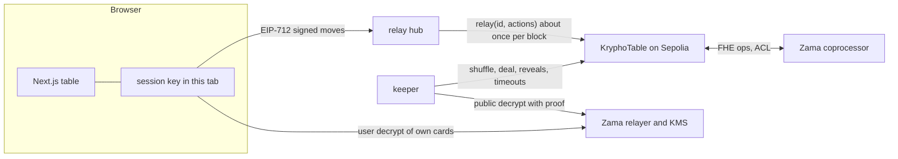

# Kryphochroma

A shedding card game in the Crazy Eights family where nobody can peek. Hands and the deck live on Sepolia as Zama FHE ciphertexts: each player decrypts only their own cards, the contract shuffles with encrypted randomness, and it checks every move without ever seeing a card.


**[Play now](https://kryphochroma.unitynodes.com)** · **[Watch the 3 minute video](https://youtu.be/VIDEO_ID)** · **[How it stays secret](https://kryphochroma.unitynodes.com/secret)**

- **Quick game**: no wallet needed. Your tab gets a session key and a little Sepolia ETH, you sit down with three bots at a table that was already shuffled on chain, and your first move lands about a minute after you click.
- **Own table and invites**: open a table for 2 to 4 players, send the link, fill the rest with bots. Connecting a wallet is optional; it signs one `join` for the session key.
- **Practice offline**: the same rules engine against local bots, no chain.

Built for the Zama Developer Program, Mainnet Season 5, Confidential Gaming.

## What would break if this were public

| Data | Type | Who can read it | When it is revealed | What breaks if it were public |
|---|---|---|---|---|
| Cards in a hand | `euint8` per slot | only the owner, through the ACL of their session key | a played card becomes public as part of the move, the rest at the end of the round for scoring | the whole game: every hand is visible, bluffing and tactics are gone |
| Deck order | `euint8[108]` | nobody, not the contract and not us | never; a drawn card only to the player who drew it | you know what you and your rivals draw next |
| "Had the colour" at a Wild Draw Four | `ebool` | nobody | only when challenged, exactly one bit | proving an honest +4 would mean showing your hand |
| Honesty of every move | `ebool` per player | nobody | once, at the end of the round | a lie would show at once instead of at the end |
| Top card, colour, direction, turn, hand sizes, who drew, who said Mono | plain state | everyone | right away | nothing, this is what you see at a real table |

[`/secret`](https://kryphochroma.unitynodes.com/secret) has a switch that shows the same table as an open contract would leak it.

## How it works



**Deck.** 108 cards, `id = colour * 16 + rank`. The keeper fills the deck with `FHE.asEuint8`, then runs a network of encrypted switches over it: for every pair, `swap = FHE.randEbool()` and two `FHE.select` calls ([`KryphoDeck.shuffleStep`](contracts/contracts/KryphoDeck.sol#L44)). 28 layers (4 passes of distances 1 to 64), each split into two transactions, 60 transactions per deck. Tables for quick games are shuffled in the background before anyone sits down.

**Hands.** Dealing copies a deck handle into your hand slot and calls `FHE.allow(card, session)`. Only your session key can decrypt it, through the Zama relayer, without a wallet popup.

**Moves and honesty.** You say which card you play. The contract checks the visible rules in plain (colour, number, turn), and folds the hidden part into an encrypted bit: `honest = FHE.and(honest, FHE.eq(hand[slot], card))` ([`play`](contracts/contracts/KryphoTable.sol#L312)). Nobody learns anything during the round. At the end, every hand and every honesty bit is made publicly decryptable in one batch and checked with `FHE.checkSignatures` ([`finishReveal`](contracts/contracts/KryphoTable.sol#L498)). A liar can not win the round and pays a penalty.

**Wild Draw Four challenge.** When a +4 is played, the contract stores one encrypted bit: did the player hold a card of the previous colour? It is `FHE.isIn(prevColour, colours of the other slots)`, with the colour of each slot computed once with `FHE.shr` when the card is drawn ([`_recordHadColor`](contracts/contracts/KryphoTable.sol#L670)). A challenge makes exactly that bit public and settles it with a KMS proof ([`resolveChallenge`](contracts/contracts/KryphoTable.sol#L438)).

**One second moves.** Moves are EIP-712 signatures from the session key. A hub checks them against the rules engine, streams them to every client at once, and submits a batch with [`relay`](contracts/contracts/KryphoTable.sol#L122) about once per block. Each action carries its seat nonce and the handle of the slot it plays, so a stale or replayed action is refused on chain. The chain stays the source of truth; clients show the projected state immediately.

**Reveals.** Every reveal goes through a handle the contract stored, `FHE.checkSignatures`, and a forward stage change. A caller never supplies the handle, and a proof can not be replayed.

**Leaving and running out.** After three timeouts in a row a seat is handed to a takeover bot: the session changes and the sealed hand is granted to the bot ([`forceTimeout`](contracts/contracts/KryphoTable.sol#L456)). When the deck runs low, the keeper encrypts the public discard into a free part of the deck and shuffles it with the same network in the background ([`reshuffleStep`](contracts/contracts/KryphoTable.sol#L222)), so play never waits.

## Verifiable randomness

- All randomness comes from `FHE.randEbool()` inside the contract. The keeper only decides when a step runs; it never sees a bit or the order.
- Shuffle quality, from a simulation of the exact network with 200,000 shuffles:

  | Layers | χ²/dof over positions | Mean total variation per card | Adjacent pairs kept (ideal 1.981) |
  |---:|---:|---:|---:|
  | 7 | 708 | 0.218 | 3.87 |
  | 14 | 15.8 | 0.034 | 2.03 |
  | 21 | 1.36 | 0.0107 | 1.99 |
  | **28 (used)** | **1.02** | **0.0093** | **1.98** |

- The first discard is revealed one card at a time, so no card that stays in the deck ever becomes public.
- A refill of the deck needs at least 16 cards unless the deck is already empty, so a refill is never a near open list.

## Contracts on Sepolia

| | |
|---|---|
| `KryphoTable` | [`0x30A6cc013262BF5502f51b472FDC3030A550cb00`](https://sepolia.etherscan.io/address/0x30A6cc013262BF5502f51b472FDC3030A550cb00) |
| Deployment | [`0xaf01ef15…57e3`](https://sepolia.etherscan.io/tx/0xaf01ef150c09fee3e55c48d37e2c71213155cf36a53cb47ba17a788a0d1457e3), block 12110896 |
| FHEVM | `@fhevm/solidity` 0.13.4, `ZamaEthereumConfig` |

A full round on chain, table 1 (one human seat that left, three bots, then the takeover bot):

| Step | Transaction |
|---|---|
| Table created | [`0xb40e49…3e3b`](https://sepolia.etherscan.io/tx/0xb40e4967a522d4647e9d2e7b74a3e53ba48838ac77b2ab55ba479068f5623e3b) |
| First of 60 shuffle steps | [`0x8f2218…9095`](https://sepolia.etherscan.io/tx/0x8f22183e63eebdd3e7f0edbc01cb121d7a55a5f4bc1db2c476c0aa46c7f59095) |
| Last shuffle step | [`0xf0e57e…2847`](https://sepolia.etherscan.io/tx/0xf0e57e64e8ee2eb7e2a67e144b92fa6087641b523852000fda0c898178d22847) |
| Starter revealed, play begins | [`0x57a90b…bcc8`](https://sepolia.etherscan.io/tx/0x57a90ba2ae1f1739943d8f0414e04172a83aee11763a756927f6a2411b1abcc8) |
| First relayed batch of signed moves | [`0xc9d05e…95da`](https://sepolia.etherscan.io/tx/0xc9d05eb0572838a11dcb3b162949f93e533d3cfbe261edc8d1ee2896494695da) |
| Round settled after the reveal | ROUND_SETTLED_TX |

`pnpm --filter @kryphochroma/bots exec tsx scripts/round-trail.ts <table id>` prints the same trail for any table.

## Cost on Sepolia

Measured on Sepolia unless noted. HCU limits there: 20M per transaction, 5M depth.

| Action | HCU | Gas |
|---|---:|---:|
| Shuffle step (half a layer, 27 switches) | ~3.5M | 7.2M to 8.5M |
| Fill step (27 cards, `asEuint8` + `allowThis`) | ~0.9k | ~3.5M |
| Deal 7 cards to a seat, with slot colours | 224k | 3.5M |
| One move check (`eq` + `and`) | 80k | 0.23M |
| Wild +4 bit (`isIn` over up to 23 colours) | 148k | 0.36M |
| `makePubliclyDecryptable` / `checkSignatures` | 0 | 0.16M / 0.38M |
| Relayed batch of 1 / 3 / 4 moves | | 0.06M / 0.82M / 0.93M |

| Latency | Time |
|---|---:|
| A signed move reaches every client | under 1 s |
| Own card decryptable after its transaction | ~3 s |
| Quick game: click to seated / to decrypted hand | ~40 s / ~75 s |
| Background shuffle of a fresh table | ~3.5 min |

## What still leaks, on purpose

- Hand slots are numbered, so you can tell that a played card is the one drawn a few turns ago. At a real table you can see that too.
- Drawing and playing at once is visible, as it is in person.
- Transaction timing can hint that a player was thinking.

Trust assumptions we accept for a testnet game:
- The relay hub can delay your moves, but it can not forge them: every action is signed by your session key and checked on chain. If the hub stops, the keeper's timeouts keep the table moving.
- The takeover key sees the hand of a seat that was abandoned, because it has to play it.
- A signed move has no expiry beyond its nonce; the hub submits within seconds.
- The switch network over 108 cards (not a power of two) is close to, not exactly, uniform: the table above is measured, not proven.

## Tests and checks

| Suite | What it covers |
|---|---|
| `packages/rules` (61) | every rule, scoring, bots, 1,000 simulated games |
| `contracts` (24) | parity with the rules engine move by move on the FHEVM mock, including relayed batches; forged and replayed proofs; privacy of hands; relay signatures and out of gas griefing; takeover; background refill |
| `services/bots` (20) | keeper planning and scheduling, faucet policy, chain view |
| `apps/web` (14 unit, 8 e2e) | seat flows, sounds, offline game; a judge scenario in Playwright with axe accessibility checks on phone and desktop |

Before going public the contracts had two independent security passes and the services one; every high finding is fixed and has a test that fails without the fix.

## Run locally

Node 22.23.4 or newer and pnpm 10.

```bash
pnpm install
pnpm lint && pnpm typecheck && pnpm test
```

Play offline against local bots:

```bash
pnpm --filter @kryphochroma/web dev
```

then open http://localhost:3310/play. The display fonts are not in the repository (their license does not allow it), so a local run falls back to system fonts.

To run the whole stack against Sepolia, copy `.env.example` to `.env`, fill in the keys, deploy with `cd contracts && npx hardhat run deploy/deploy.ts --network sepolia`, then start `services/bots` (`pnpm --filter @kryphochroma/bots build && node services/bots/dist/service/main.js`) and the web app. `infra/` has the systemd units and the Caddy site we run in production.

## Repository

| Path | What |
|---|---|
| `contracts/` | `KryphoTable`, `KryphoDeck`, `CardLib`; Hardhat 3 with the FHEVM plugin |
| `packages/rules` | rules engine shared by the client, the bots and the contract tests |
| `packages/abi` | generated ABI, chain views, signed action helpers |
| `packages/cards` | SVG card faces and backs |
| `apps/web` | Next.js client |
| `services/bots` | keeper, shuffler, relay hub and bots |
| `infra/` | systemd units and Caddy site |

## License

MIT
