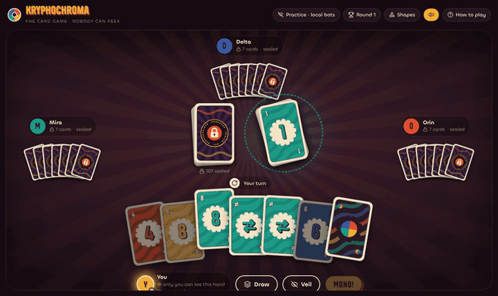
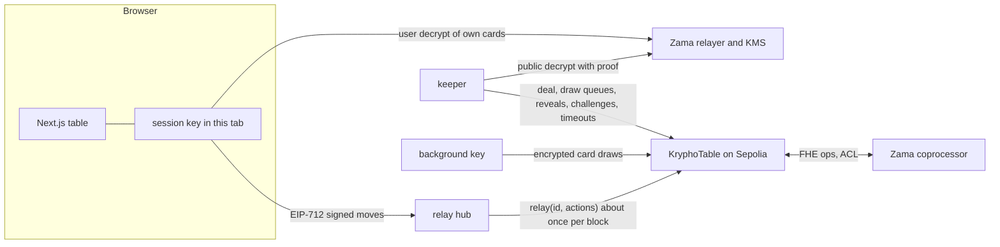

# Kryphochroma

A five colour shedding card game where hiding is the game. Bluff with a veiled card, spy on one sealed card with a spyglass, ping a rival hand with a sonar, chase a secret colour that doubles your round. Hands, the deck, veiled cards and secret colours live on Sepolia as Zama FHE ciphertexts: the contract draws, deals and checks every move without ever seeing a card.



**[Play now](https://kryphochroma.unitynodes.com)** · **[Watch the 3 minute video](https://youtu.be/VIDEO_ID)** · **[Docs](https://kryphochroma.unitynodes.com/docs)** · **[How it stays secret](https://kryphochroma.unitynodes.com/secret)**

- **Quick game**: no wallet and no test ETH needed. Your tab makes a session key and signs its seat, a relayer puts it on chain, and you sit down with three bots at a table whose cards were already drawn.
- **With friends**: open a table for 2 to 4 players and send the invite link. Play opens by itself when the last seat is taken, or the host starts earlier and bots take the empty seats. Open tables are listed so anyone can join. A wallet is optional; it signs one `join` for the session key.
- **Practice offline**: the same rules engine against local bots, no chain.
- **Radio**: eleven free internet stations at the table, from old time jazz to lo-fi and synthwave, streamed straight from their operators. Nothing plays until you press play.

Built for the Zama Developer Program, Mainnet Season 5, Confidential Gaming.

## The game

138 cards in five colours (red, sun, teal, blue, violet). Match the top card by colour or number, empty your hand first, score what is left in the other hands. Skip, Reverse, Draw Two and wilds work as you would expect. Four mechanics only exist because every card is encrypted:

| Mechanic | What you do | What happens on chain |
|---|---|---|
| **Veil** | Once per round, lay any card face down and name a number card that fits the pile. The next player may doubt you: a lie draws 4, a wrong doubt draws 2. | The real card stays an encrypted handle. The contract stores `FHE.eq(real, named)`; only a doubt makes that one bit public, settled with a KMS proof. |
| **Spyglass** | A coloured action card. Play it and look at one sealed card of a rival. | `FHE.allow(hand[target][slot], your session key)`. Everyone sees which slot you looked at, nobody else sees the card. |
| **Sonar** | Once per round, instead of your move, ask how many cards of one colour a rival holds. | The contract counts inside the encrypted hand: `FHE.add` of `FHE.select(FHE.eq(colour[slot], asked), 1, 0)`, then `FHE.allow(count, your session key)`. The table sees the ping, only you see the number. |
| **Secret colour** | You get a hidden colour at the deal. Go out on a card of that colour and the round counts double. | `FHE.rem(FHE.randEuint8(), 5)`, allowed only to you, revealed with the hands at the end of the round. |

A drawn card opens at once. Each seat keeps a queue of two deck handles, `FHE.allow`ed to its session key right after the deal and topped up from the deck on every draw. The handle moves from the queue into the hand, so the browser already holds its value and a move can name it before the draw is mined. The table never shows the queue.

## What would break if this were public

| Data | Type | Who can read it | Revealed | If it were public |
|---|---|---|---|---|
| Cards in a hand | `euint8` per slot | owner only | played cards with the move, the rest at round end | every hand is visible, no tactics left |
| Deck order | `euint8[138]` | nobody, not the contract and not us | never; a seat's key can open only its own next two draws | you know every draw in advance |
| Veiled card | `euint8` + `ebool` | nobody | one bit, only if doubted | a veil is a lie anyone can check |
| Spyglass target | `FHE.allow` to one key | the spyglass player | never to the rest | the peek is shown to the whole table |
| Sonar answer | `euint8` | the player who pinged | never | a rival knows exactly what you learned |
| Secret colour | `euint8` | owner only | round end | rivals block your colour |
| "Had the colour" at a Wild +4 | `ebool` | nobody | one bit, only if challenged | proving an honest +4 means showing your hand |
| Honesty of every move | `ebool` per player | nobody | once, at round end | a lie shows at once instead of at the end |

[`/secret`](https://kryphochroma.unitynodes.com/secret) has a switch that shows the same table as an open contract would leak it.

## How it works



- **Deck.** `id = colour * 16 + rank`, with the odds of a 138 card deck. Nothing is shuffled: every card is its own encrypted draw. A 16 bit `FHE.randEuint16` is scaled to an index from 0 to 137 and turned into a card on ciphertexts ([`KryphoDeck.randomCard`](contracts/contracts/KryphoDeck.sol)). A table draws its 138 cards in 12 transactions in the background, about 30 s, before anyone sits down.
- **Hands.** Dealing copies a deck handle into your hand slot and calls `FHE.allow(card, session)`. Only your session key can decrypt it, without a wallet popup.
- **Moves and honesty.** You say which card you play. The contract checks the public rules in plain and folds the hidden part into `honest = FHE.and(honest, FHE.eq(hand[slot], card))`. All honesty bits are revealed once at the end of the round with `FHE.checkSignatures`; a liar can not win.
- **Veil and Wild +4.** Both store one encrypted bit and share one challenge stage: a doubt or a challenge makes exactly that bit public and settles it with a KMS proof.
- **One second moves.** Moves are EIP-712 signatures from the session key. A hub checks them with the rules engine, streams them to every client at once and submits a batch with `relay` about once per block. Seat nonces and the handle of the played slot make stale or replayed actions fail on chain; a relayed action that runs out of gas reverts the whole batch, so nobody can burn your move.
- **Leaving and running out.** After three timeouts in a row a takeover bot plays the seat with its sealed hand. When the deck is down to 48 cards, a background key draws up to 60 fresh cards into a free part of the deck while play goes on. Played cards never come back.
- **Size.** The card draws, scoring, signatures and sonar, the lobby and the draw path live in linked libraries (`KryphoDeck`, `KryphoScore`, `KryphoRadio`, `KryphoLobby`, `KryphoHand`) so `KryphoTable` stays under the 24 KB limit.

## Verifiable randomness

- All randomness comes from `FHE.randEuint16()` and `FHE.randEuint8()` inside the contract. The keeper only decides when a step runs; it never sees a card.
- Scaling a 16 bit draw to 138 keeps every card within 0.2 percent of its share of a real deck. Cards are independent, so card counting tells you nothing about the next draw.
- Why no shuffle: the first version ran a 32 layer network of encrypted switches, 70 transactions and about 600M gas per table, and stored every intermediate ciphertext on the shared Zama coprocessor. Drawing each card on its own stores 138 ciphertexts per table instead of about 9,000, at about 64M gas, and a table is ready in half a minute instead of four.
- The first discard is revealed one card at a time, so no card that stays in the deck ever becomes public.
- The secret colour uses `rem 5` over a byte: 0 has a 52/256 chance instead of 51/256.

## Contracts on Sepolia

| | |
|---|---|
| `KryphoTable` | [`0x26512e9708d904a9B96396C488040153e9d4d773`](https://sepolia.etherscan.io/address/0x26512e9708d904a9B96396C488040153e9d4d773) |
| `KryphoDeck` library | [`0x49c668313FC36C7adb4D0A6B949cB36d0D19676d`](https://sepolia.etherscan.io/address/0x49c668313FC36C7adb4D0A6B949cB36d0D19676d) |
| `KryphoScore` library | [`0x1dB61d9DF9C6a1Af11fe8475b8AecAa2CD36Fb44`](https://sepolia.etherscan.io/address/0x1dB61d9DF9C6a1Af11fe8475b8AecAa2CD36Fb44) |
| `KryphoRadio` library (sonar, signatures) | [`0xc6ec8fc1d3E3c2F34b3d4aF28c72C1A570B7487a`](https://sepolia.etherscan.io/address/0xc6ec8fc1d3E3c2F34b3d4aF28c72C1A570B7487a) |
| `KryphoLobby` library (join, leave, host) | [`0x20D342B0E4D6337d9CbC624f5d5d55A2AA0b4ED2`](https://sepolia.etherscan.io/address/0x20D342B0E4D6337d9CbC624f5d5d55A2AA0b4ED2) |
| `KryphoHand` library (dealing, draw queues, proofs) | [`0x8d71DB364FCE0F0a4472EfEC6B5Bdc1fBfc21AeD`](https://sepolia.etherscan.io/address/0x8d71DB364FCE0F0a4472EfEC6B5Bdc1fBfc21AeD) |
| Deployment | [`0x42e7cf…5eec9`](https://sepolia.etherscan.io/tx/0x42e7cf30f59d173b3552472ad242c7f663d331db0da7e6d10232548f3505eec9), block 12167981 |

A full round on this deployment, table 9: four seats, four veils, one of them doubted and settled while 30 more moves were played, a spyglass peek, three sonar pings, Mono, a seat taken over after three timeouts and the reveal.

| Step | Transaction |
|---|---|
| Table created | [`0xafc0b9…897e`](https://sepolia.etherscan.io/tx/0xafc0b92441117d73b572c41b7ceb29af6be6b47fc32bd131ef33d52ccb83897e) |
| First of 12 draw steps | [`0x541d1f…46a4`](https://sepolia.etherscan.io/tx/0x541d1f2397df63eb0dd9c34f7103332d01999ea2c4be54e1e5e36afdf40f46a4) |
| Last seat joins, hands dealt, play begins | [`0x432fe9…f1c5`](https://sepolia.etherscan.io/tx/0x432fe9c728249f88bb809ba0132c9d01785cd24ff03059c5aaac95c3f9f6f1c5) |
| Batch of signed moves with three veils | [`0x117e18…fc16`](https://sepolia.etherscan.io/tx/0x117e18caf66bc156dad21ceb09fbdf4a5470fd05244da38c9e964d954ccefc16) |
| A veil is doubted, play goes on | [`0x1db428…0507`](https://sepolia.etherscan.io/tx/0x1db428a8436f149786bb9851379e66f8181ba08f9dadfaed83fd81c659570507) |
| The doubted bit is opened 30 moves later, the bluffer draws 4 | [`0x23054e…547a`](https://sepolia.etherscan.io/tx/0x23054ec3851ff460b6a96450164e5df9ea6d4c88a06dc76516cefecac821547a) |
| Batch with a sonar ping | [`0x766028…8a49`](https://sepolia.etherscan.io/tx/0x7660288ee33eabb63a9a233808818cf64063b32291a3f5d3178aee256df68a49) |
| Third timeout, the takeover bot gets the seat | [`0x84fed4…e02a`](https://sepolia.etherscan.io/tx/0x84fed45c9b34893d5b6e8d0bf83626dcf182b725aacc899b15bf77fd651ee02a) |
| Batch with a spyglass peek | [`0x1663da…0f10`](https://sepolia.etherscan.io/tx/0x1663da267092f029b25691ba2fe499e9db49d47c0a6daa3d271a613217d20f10) |
| Reveal started | [`0x2f030e…a3f8`](https://sepolia.etherscan.io/tx/0x2f030e1bf4462fc62501d5b6c19c5a00077d78405af190e32b9eb208e130a3f8) |
| Round settled with secret colours | [`0x12d847…d341`](https://sepolia.etherscan.io/tx/0x12d8472fc783da9143339fd89a411f1db7f7eedea421e408563169274858d341) |

The deck refill, which a short round does not reach, is in table 5 on the previous deployment: [`0x04fd2a…6327`](https://sepolia.etherscan.io/tx/0x04fd2a2895e76304f2dc625f97f18b968a98cb2eb3732e45b84463039ea46327).

`pnpm --filter @kryphochroma/bots exec tsx scripts/round-trail.ts <table id>` prints the same trail for any table.

## Cost on Sepolia

HCU limits on Sepolia: 20M per transaction, 5M depth.

| Action | HCU | Gas |
|---|---:|---:|
| Draw step (12 cards, `randEuint16` + 13 ops each) | ~14M | 5.78M |
| Deal 7 cards to a seat, with slot colours and a secret colour | ~0.3M | ~3.6M |
| Join that fills a 4 seat table and deals every hand | ~1.2M | 15.77M |
| One move check (`eq` + `and`) | 80k | 0.23M |
| Veil bit / Wild +4 bit (`eq` / `isIn`) | 80k / 148k | 0.3M / 0.36M |
| Spyglass (`FHE.allow`) | 0 | ~0.1M extra |
| Sonar (`eq` + `select` + `add` per card, `allow`) | 3 ops per card in the hand | relayed batch of 4 moves with a sonar: 1.02M ([`0x9f4efc…9191`](https://sepolia.etherscan.io/tx/0x9f4efc0f6cd744e43d4028ec17b615b8fb32c479f8fdf26ce219f460c41b9191)) |
| `makePubliclyDecryptable` / `checkSignatures` | 0 | 0.16M / 0.38M |
| Relayed batch of 1 / 3 / 4 moves | | 0.06M / 0.82M / 0.93M |

| Latency | Time |
|---|---:|
| A signed move reaches every client | under 1 s |
| Quick game: click to your hand face up. Three bots already wait at a table with its cards drawn, the guest signs its join and the relayer submits it, so the guest key needs no faucet top up; the join deals in the same block | 12 s to 21 s: one block, then ~5 s of decryption |
| With friends: click to lobby, from a ready table | under 1 s, the seat lands one block later |
| Last seat taken to play, starter revealed in the lobby | same block (~12 s) |
| Hand decrypted after play opens | ~4 s to 9 s |
| A drawn card from your queue, face up in your hand | under 1 s once the queue is decrypted; a draw in the first seconds of a round, or one that empties the queue faster than a block, waits 10 s to 20 s |
| Round over to scores on screen at a table with bots: the table server sends the bot hands only after the chain has reached the reveal, then the browser scores them with the same rules | 16 s to 32 s, one or two blocks |
| Scores on screen to scores proven on chain: Zama KMS decrypts every hand in public and `finishReveal` checks its signatures | 25 s to 45 s more; the table shows Verified on Sepolia when it lands |
| Background draw of a fresh table | ~30 s |

## What still shows, on purpose

- Hand slots are numbered, so you can tell a played card is the one drawn a few turns ago. At a real table you see that too.
- Everyone sees which slot a spyglass looked at, but not the card.
- Drawing and playing at once is visible, as it is in person. Transaction timing can hint that a player was thinking.

Trust assumptions we accept for a testnet game:
- Bot hands are sent to the table only after the chain itself has reached the reveal, never from moves still waiting for a block, so a player can not see them while the round can still go on. A sonar count on a bot is cut from the public stream.
- A lie costs up to 100 of the liar's own points and the liar can not win; in a single round everyone starts at 0, so there the only cost is losing the round and the public `lied` mark. A player willing to pay that can claim a spyglass they do not hold and still read one rival card.
- The relay hub can delay moves but can not forge them: every action is signed by the session key and checked on chain.
- The takeover key sees the hand of a seat that was abandoned, because it has to play it.
- A seat's key can open its own next two draws, which is what makes a drawn card appear at once. The table does not show them, but a player who inspects their own browser can read them. Nobody can read another seat's queue.
- A signed move has no expiry beyond its nonce; the hub submits within seconds. A relayed join names only its table, so it can be submitted again if that seat leaves the lobby, and `join` lets anyone seat another session address. Both cost a lobby seat at most, never a card or a move.

## Tests and checks

| Suite | What it covers |
|---|---|
| `packages/rules` (81) | every rule including veil, spyglass, sonar, secret colour and the draw queues; scoring; bots; 1,000 simulated games |
| `contracts` (35) | parity with the rules engine move by move on the FHEVM mock, including relayed batches with veils, spyglasses and sonar pings; forged and replayed proofs; privacy of hands, peeks, sonar answers and secret colours; relay signatures and out of gas griefing; leaving a lobby and host handover; a starter revealed in the lobby and play opened by the join that fills the table; takeover; draw queues; relayed joins; background refill with fresh draws |
| `services/bots` (80) | keeper planning and scheduling, quick game pool, pipelined relay batches, bot hands revealed only from chain state, hub reads pinned to one block, faucet and relayer budgets, action parsing, chain view |
| `apps/web` (73 unit, 12 e2e) | seat flows, seats taken in the background, the score shown before the proof, wait hints, the API proxy limits, sounds, the radio, offline game; a judge scenario in Playwright with axe accessibility checks on phone and desktop |

Before going public the contracts had two independent security passes and the services one, and the whole stack had a full audit after the move to independent draws. Every critical and high finding that could be fixed without a new deployment is fixed and has a test that fails without the fix; what is left is listed under the trust assumptions above.

## Run locally

Node 22.23.4 or newer and pnpm 10.

```bash
pnpm install
pnpm lint && pnpm typecheck && pnpm test
```

Play offline against local bots:

```bash
pnpm --filter @kryphochroma/web dev
```

then open http://localhost:3310/play. The display fonts are not in the repository (their license does not allow it), so a local run falls back to system fonts.

To run the whole stack against Sepolia, copy `.env.example` to `.env`, fill in the keys, deploy with `cd contracts && npx hardhat run deploy/deploy.ts --network sepolia`, then build and start `services/bots` and the web app. `infra/` has the systemd units and the Caddy site we run in production.

## Repository

| Path | What |
|---|---|
| `contracts/` | `KryphoTable` and its libraries `KryphoDeck`, `KryphoScore`, `KryphoRadio`, `KryphoLobby`, `KryphoHand`, `CardLib`; Hardhat 3 with the FHEVM plugin |
| `packages/rules` | rules engine shared by the client, the bots and the contract tests |
| `packages/abi` | generated ABI, chain views, signed action helpers |
| `packages/cards` | SVG card faces and backs |
| `apps/web` | Next.js client, docs and privacy page |
| `services/bots` | keeper, background card draws, relay hub, seat relayer and bots |
| `infra/` | systemd units and Caddy site |

## License

MIT
