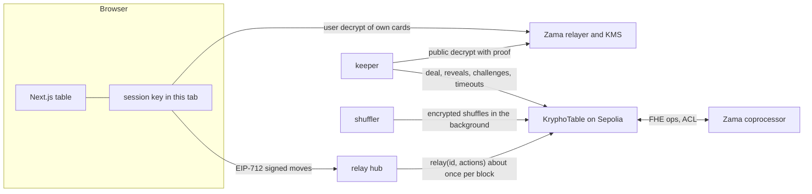

# Kryphochroma

A five colour shedding card game where hiding is the game. Bluff with a veiled card, spy on one sealed card with a spyglass, ping a rival hand with a sonar, chase a secret colour that doubles your round. Hands, the deck, veiled cards and secret colours live on Sepolia as Zama FHE ciphertexts: the contract shuffles, deals and checks every move without ever seeing a card.


**[Play now](https://kryphochroma.unitynodes.com)** · **[Watch the 3 minute video](https://youtu.be/VIDEO_ID)** · **[Docs](https://kryphochroma.unitynodes.com/docs)** · **[How it stays secret](https://kryphochroma.unitynodes.com/secret)**

- **Quick game**: no wallet needed. Your tab gets a session key and a little Sepolia ETH, and you sit down with three bots at a table that was already shuffled on chain.
- **With friends**: open a table for 2 to 4 players, send the invite link, start when everyone is in. Open tables are listed so anyone can join. A wallet is optional; it signs one `join` for the session key.
- **Practice offline**: the same rules engine against local bots, no chain.
- **Kryphochroma FM**: three radio stations composed live in your browser, no tracks. The beat speeds up when someone is down to one card.

Built for the Zama Developer Program, Mainnet Season 5, Confidential Gaming.

## The game

138 cards in five colours (red, sun, teal, blue, violet). Match the top card by colour or number, empty your hand first, score what is left in the other hands. Skip, Reverse, Draw Two and wilds work as you would expect. One rule differs from a paper deck: you see your own next two draws, and nobody else does. Four mechanics only exist because every card is encrypted:

| Mechanic | What you do | What happens on chain |
|---|---|---|
| **Veil** | Once per round, lay any card face down and name a number card that fits the pile. The next player may doubt you: a lie draws 4, a wrong doubt draws 2. | The real card stays an encrypted handle. The contract stores `FHE.eq(real, named)`; only a doubt makes that one bit public, settled with a KMS proof. |
| **Spyglass** | A coloured action card. Play it and look at one sealed card of a rival. | `FHE.allow(hand[target][slot], your session key)`. Everyone sees which slot you looked at, nobody else sees the card. |
| **Sonar** | Once per round, instead of your move, ask how many cards of one colour a rival holds. | The contract counts inside the encrypted hand: `FHE.add` of `FHE.select(FHE.eq(colour[slot], asked), 1, 0)`, then `FHE.allow(count, your session key)`. The table sees the ping, only you see the number. |
| **Secret colour** | You get a hidden colour at the deal. Go out on a card of that colour and the round counts double. | `FHE.rem(FHE.randEuint8(), 5)`, allowed only to you, revealed with the hands at the end of the round. |
| **Next draws** | Your next two cards wait beside the deck, visible only to you. A draw puts the first one straight into your hand. | Each seat keeps a queue of two deck handles, `FHE.allow`ed to its session key at the deal and topped up from the deck on every draw. The handle moves from the queue into the hand, so your browser already holds its value and a move can name it before the draw is mined. |

## What would break if this were public

| Data | Type | Who can read it | Revealed | If it were public |
|---|---|---|---|---|
| Cards in a hand | `euint8` per slot | owner only | played cards with the move, the rest at round end | every hand is visible, no tactics left |
| Deck order | `euint8[138]` | nobody, not the contract and not us | never; each seat sees only its own next two draws | you know every draw in advance |
| Veiled card | `euint8` + `ebool` | nobody | one bit, only if doubted | a veil is a lie anyone can check |
| Spyglass target | `FHE.allow` to one key | the spyglass player | never to the rest | the peek is shown to the whole table |
| Sonar answer | `euint8` | the player who pinged | never | a rival knows exactly what you learned |
| Secret colour | `euint8` | owner only | round end | rivals block your colour |
| "Had the colour" at a Wild +4 | `ebool` | nobody | one bit, only if challenged | proving an honest +4 means showing your hand |
| Honesty of every move | `ebool` per player | nobody | once, at round end | a lie shows at once instead of at the end |

[`/secret`](https://kryphochroma.unitynodes.com/secret) has a switch that shows the same table as an open contract would leak it.

## How it works



- **Deck.** 138 cards, `id = colour * 16 + rank`. A shuffler fills the deck with `FHE.asEuint8` and runs a network of encrypted switches: for every pair, `swap = FHE.randEbool()` and two `FHE.select` calls ([`KryphoDeck.shuffleStep`](contracts/contracts/KryphoDeck.sol)). 32 layers, 70 transactions per deck, done in the background before anyone sits down.
- **Hands.** Dealing copies a deck handle into your hand slot and calls `FHE.allow(card, session)`. Only your session key can decrypt it, without a wallet popup.
- **Moves and honesty.** You say which card you play. The contract checks the public rules in plain and folds the hidden part into `honest = FHE.and(honest, FHE.eq(hand[slot], card))`. All honesty bits are revealed once at the end of the round with `FHE.checkSignatures`; a liar can not win.
- **Veil and Wild +4.** Both store one encrypted bit and share one challenge stage: a doubt or a challenge makes exactly that bit public and settles it with a KMS proof.
- **One second moves.** Moves are EIP-712 signatures from the session key. A hub checks them with the rules engine, streams them to every client at once and submits a batch with `relay` about once per block. Seat nonces and the handle of the played slot make stale or replayed actions fail on chain; a relayed action that runs out of gas reverts the whole batch, so nobody can burn your move.
- **Leaving and running out.** After three timeouts in a row a takeover bot plays the seat with its sealed hand. When the deck runs low, the shuffler encrypts the public discard into a free part of the deck and shuffles it while play goes on.
- **Size.** Deck steps and scoring live in linked libraries (`KryphoDeck`, `KryphoScore`) so `KryphoTable` stays under the 24 KB limit.

## Verifiable randomness

- All randomness comes from `FHE.randEbool()` and `FHE.randEuint8()` inside the contract. The keeper only decides when a step runs; it never sees a bit or the order.
- A simulation of the switch network with 200,000 shuffles over the 108 card deck showed 28 layers indistinguishable from uniform (χ²/dof 1.02, mean total variation 0.0093 per card). The 138 card deck uses 32 layers.
- The first discard is revealed one card at a time, so no card that stays in the deck ever becomes public.
- The secret colour uses `rem 5` over a byte: 0 has a 52/256 chance instead of 51/256.

## Contracts on Sepolia

| | |
|---|---|
| `KryphoTable` | [`0x118C8298257121403f40c1ca0b402C20106D0461`](https://sepolia.etherscan.io/address/0x118C8298257121403f40c1ca0b402C20106D0461) |
| `KryphoDeck` library | [`0x919ff8160C8fF09a8cDAfe682e22A9bBD529Da50`](https://sepolia.etherscan.io/address/0x919ff8160C8fF09a8cDAfe682e22A9bBD529Da50) |
| `KryphoScore` library | [`0x3999F0b1830c9E1fF232D1B10820974e89304830`](https://sepolia.etherscan.io/address/0x3999F0b1830c9E1fF232D1B10820974e89304830) |
| `KryphoRadio` library (sonar, signatures) | [`0x0F8c85E2002c0fbD0E8ED4D57b8a918EDb160837`](https://sepolia.etherscan.io/address/0x0F8c85E2002c0fbD0E8ED4D57b8a918EDb160837) |
| `KryphoLobby` library (join, leave, host) | [`0x59F0701221c34cE8e24c165d48989CF7634A57a3`](https://sepolia.etherscan.io/address/0x59F0701221c34cE8e24c165d48989CF7634A57a3) |
| `KryphoHand` library (dealing, draw queues, proofs) | [`0x58FAB0c6a5288523DB25F162F3219f5Ac47713A3`](https://sepolia.etherscan.io/address/0x58FAB0c6a5288523DB25F162F3219f5Ac47713A3) |
| Deployment | [`0xd19b49…c8bfa`](https://sepolia.etherscan.io/tx/0xd19b4992b77be736fe3ddbd403138afd68bf4d6e3f033b579c787647df6c8bfa), block 12123055 |

A full round on chain on the previous deployment with the same rules, table 2: one human, three bots, three veils, one spyglass, Mono, a timeout and the reveal.

| Step | Transaction |
|---|---|
| Table created | [`0xfe794f…6017`](https://sepolia.etherscan.io/tx/0xfe794f0d5793844e681c74b80a56420a46ab8990d45256c06a9cd31417617276) |
| First of 70 shuffle steps | [`0xbdadae…e727`](https://sepolia.etherscan.io/tx/0xbdadaeea60fffc3f23cbca68d57309ce98a3db666d494c1df89f11d895f1e727) |
| Starter revealed, play begins | [`0x1382c5…931c`](https://sepolia.etherscan.io/tx/0x1382c5180113bc7bb9acece21e8bf23e618db927441e5b2efb2e4ec37119931c) |
| Batch of signed moves with a veil | [`0x4f5ecc…1e98`](https://sepolia.etherscan.io/tx/0x4f5ecc974f70dba2d0a1f89790d9c3ffec64b89562b27fb5dbe4fdd913971e98) |
| Batch with a spyglass peek | [`0xc1fcb0…4134`](https://sepolia.etherscan.io/tx/0xc1fcb0ae3e1012294523e0a5772b70c40ab404977455a47e3382fda539664134) |
| Reveal started | [`0xf927b1…5bef`](https://sepolia.etherscan.io/tx/0xf927b1949c7d06633aa0c9a35439acc1979d5373195dcb54226972fc10925bef) |
| Round settled with secret colours | [`0xb71e0d…9a62`](https://sepolia.etherscan.io/tx/0xb71e0d068106e828a20cab9c158c8c05b563611d9cfed95c11dc6b5fc67e9a62) |

`pnpm --filter @kryphochroma/bots exec tsx scripts/round-trail.ts <table id>` prints the same trail for any table.

## Cost on Sepolia

HCU limits on Sepolia: 20M per transaction, 5M depth.

| Action | HCU | Gas |
|---|---:|---:|
| Shuffle step (half a layer) | ~3.5M to 4.5M | 7M to 11M |
| Deal 7 cards to a seat, with slot colours and a secret colour | ~0.3M | ~3.6M |
| Join that fills a 4 seat table and deals every hand | ~1.2M | 15.73M |
| One move check (`eq` + `and`) | 80k | 0.23M |
| Veil bit / Wild +4 bit (`eq` / `isIn`) | 80k / 148k | 0.3M / 0.36M |
| Spyglass (`FHE.allow`) | 0 | ~0.1M extra |
| Sonar (`eq` + `select` + `add` per card, `allow`) | 3 ops per card in the hand | relayed batch of 4 moves with a sonar: 1.02M ([`0x9f4efc…9191`](https://sepolia.etherscan.io/tx/0x9f4efc0f6cd744e43d4028ec17b615b8fb32c479f8fdf26ce219f460c41b9191)) |
| `makePubliclyDecryptable` / `checkSignatures` | 0 | 0.16M / 0.38M |
| Relayed batch of 1 / 3 / 4 moves | | 0.06M / 0.82M / 0.93M |

| Latency | Time |
|---|---:|
| A signed move reaches every client | under 1 s |
| Own card decryptable after its transaction | ~3 s |
| Quick game: click to table / to play | under 1 s / when the last bot join lands, one or two blocks |
| With friends: click to lobby, from a ready shuffled table | under 1 s, the seat lands one block later |
| Last seat taken to play, starter revealed in the lobby | same block (~12 s) |
| Hand decrypted after play opens | ~4 s to 9 s |
| A drawn card from your queue, face up in your hand | under 1 s; a draw that empties the queue faster than a block waits ~10 s for the refill |
| Last move of a round to scores on chain: the relayed batch that ends the round also opens every hand, `finishReveal` follows once the KMS answers | 12 s to 40 s, mostly the public decryption |
| Background shuffle of a fresh table | ~4 min |

## What still shows, on purpose

- Hand slots are numbered, so you can tell a played card is the one drawn a few turns ago. At a real table you see that too.
- Everyone sees which slot a spyglass looked at, but not the card.
- Drawing and playing at once is visible, as it is in person. Transaction timing can hint that a player was thinking.

Trust assumptions we accept for a testnet game:
- The relay hub can delay moves but can not forge them: every action is signed by the session key and checked on chain.
- The takeover key sees the hand of a seat that was abandoned, because it has to play it.
- A signed move has no expiry beyond its nonce; the hub submits within seconds.

## Tests and checks

| Suite | What it covers |
|---|---|
| `packages/rules` (76) | every rule including veil, spyglass, sonar and secret colour; scoring; bots; 1,000 simulated games |
| `contracts` (32) | parity with the rules engine move by move on the FHEVM mock, including relayed batches with veils, spyglasses and sonar pings; forged and replayed proofs; privacy of hands, peeks, sonar answers and secret colours; relay signatures and out of gas griefing; leaving a lobby and host handover; a starter revealed in the lobby and play opened by the join that fills the table; takeover; background refill |
| `services/bots` (40) | keeper planning and scheduling, quick game pool, hub reads pinned to one block, faucet policy, action parsing, chain view |
| `apps/web` (35 unit, 12 e2e) | seat flows, seats taken in the background, sounds, the radio, offline game; a judge scenario in Playwright with axe accessibility checks on phone and desktop |

Before going public the contracts had two independent security passes and the services one; every high finding is fixed and has a test that fails without the fix.

## Run locally

Node 22.23.4 or newer and pnpm 10.

```bash
pnpm install
pnpm lint && pnpm typecheck && pnpm test
```

Play offline against local bots:

```bash
pnpm --filter @kryphochroma/web dev
```

then open http://localhost:3310/play. The display fonts are not in the repository (their license does not allow it), so a local run falls back to system fonts.

To run the whole stack against Sepolia, copy `.env.example` to `.env`, fill in the keys, deploy with `cd contracts && npx hardhat run deploy/deploy.ts --network sepolia`, then build and start `services/bots` and the web app. `infra/` has the systemd units and the Caddy site we run in production.

## Repository

| Path | What |
|---|---|
| `contracts/` | `KryphoTable`, `KryphoDeck`, `KryphoScore`, `CardLib`; Hardhat 3 with the FHEVM plugin |
| `packages/rules` | rules engine shared by the client, the bots and the contract tests |
| `packages/abi` | generated ABI, chain views, signed action helpers |
| `packages/cards` | SVG card faces and backs |
| `apps/web` | Next.js client, docs and privacy page |
| `services/bots` | keeper, shuffler, relay hub and bots |
| `infra/` | systemd units and Caddy site |

## License

MIT
